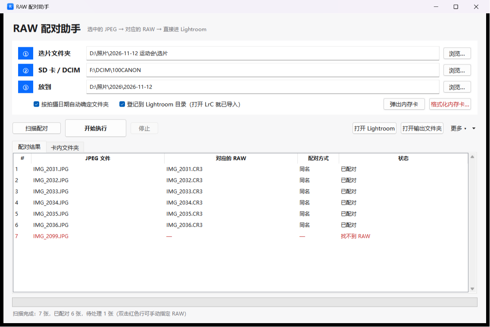
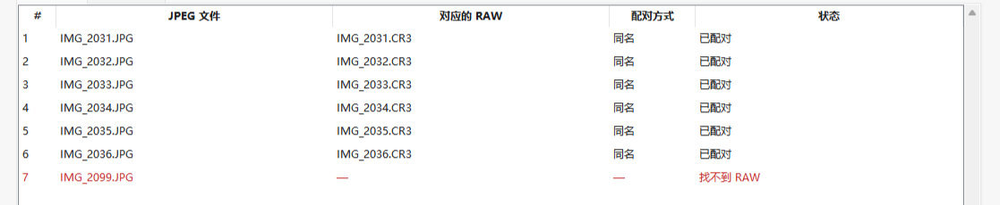
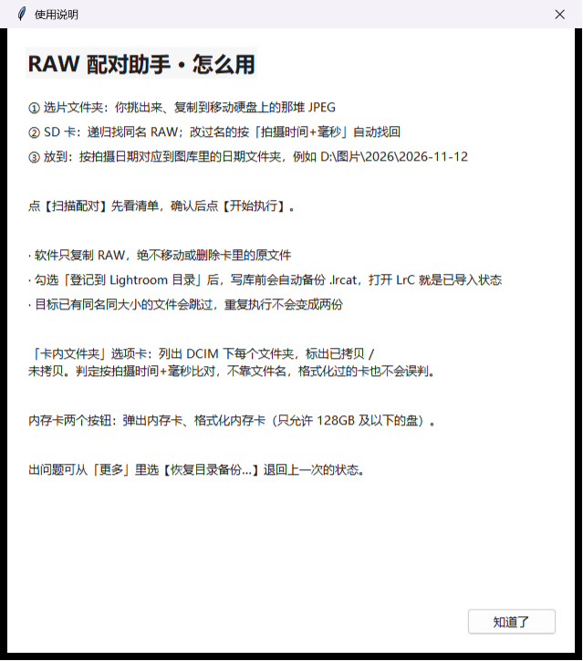

# RAW 配对助手（rawmate）

拍完 RAW+JPG 双格式，卡里每张照片是 `IMG_2031.JPG` 和 `IMG_2031.CR3` 两个文件。
这个工具按你**选好的 JPEG** 把对应的 RAW 配出来，只把 RAW 拷进图库，并直接登记进 Lightroom 目录——
打开 LrC 就是「已导入」状态，不用再走一遍导入。

纯 Python 标准库 + tkinter，**零第三方依赖**，拷到任何装了 Python 3.9+ 的 Windows 机器就能跑。



> 截图使用演示数据，路径和文件名为虚构。

## 三步

| ① 选片文件夹 | ② SD 卡 / DCIM | ③ 放到 |
|---|---|---|
| 你挑出来、复制到硬盘上的那批 JPEG | 卡上 DCIM 目录（自动识别插卡） | 按拍摄日期落到图库日期文件夹 |

点 **扫描配对** 先看清单，确认后点 **开始执行**。

## 配对是怎么做的

1. **先按文件名**——`IMG_2031.JPG` ↔ `IMG_2031.CR3`，同一目录递归找同名 RAW。
2. **配不上再按时间**——用 JPEG 的「拍摄时间 + 毫秒」去卡上反查 RAW 的 EXIF。改过名的、卡被格式化过的也能对回来。
3. **还是配不上**——那一行标红显示「找不到 RAW」，双击手动指定，不会自作主张乱配。

配不上的行在界面里是红色的，一眼能看见：



## 拷贝怎么保证不出事

这是拷卡工具最该守的底线，代码里是硬约束：

- **只复制 RAW，绝不移除、不删除卡里的原文件**——卡怎么插进来就怎么拔出去
- **先写临时文件 → 校验大小 → 再原子改名**，中途断电/拔卡不会留下半截文件
- **目标已有同名同大小的文件就跳过**，误点两次「开始执行」不会变成两份
- **写 Lightroom 库之前自动备份 `.lrcat`**，出问题用「更多 → 恢复目录备份…」一键退回

## Lightroom 集成

- 直接读写 `.lrcat`（就是 SQLite），不需要开 LrC
- 勾选「登记到 Lightroom 目录」后，拷完的 RAW 会写进目录，**打开 LrC 即是已导入状态**
- 顺手处理了 Lightroom 的内部 XMP 包，导入后不出现「元数据待更新」

## 卡状态与擦卡

「卡内文件夹」选项卡列出 DCIM 下每个文件夹，标出**已拷贝 / 未拷贝**（按照片数算，不是按文件名猜），
避免重复拷、也避免漏拷。

```
共 1 个文件夹：0 个已拷贝，1 个未拷贝
100CANON        6 张     未拷贝 (0/6)
```

另外两个按钮：**弹出内存卡**、**格式化内存卡**。格式化走系统提权、只允许 128 GB 及以下的盘，
并且会先校验目标不是你的图库所在盘。

## 使用说明弹窗



## 运行

```bash
python -m rawmate
```

或在项目上级目录：

```bash
python -c "from rawmate.ui import main; main()"
```

状态、报告、`.lrcat` 备份默认写在 `%APPDATA%\RAW配对助手`，可用环境变量 `RAWMATE_HOME` 改到别处。

## 代码结构

```
rawmate/
  ui.py            图形界面（tkinter）、主流程、线程与队列
  matcher.py       配对引擎：文件名优先，回退「拍摄时间+毫秒」
  copier.py        复制与校验：临时文件 → 校验 → 原子改名
  exif.py          EXIF 解析（纯标准库，JPEG + TIFF 系 RAW）
  catalog.py       Lightroom .lrcat 读写（SQLite）
  xmp.py           Lightroom 内部 XMP 包生成
  detect.py        盘符/文件夹识别：找卡、找图库、猜选片目录
  cardstatus.py    DCIM 已拷状态判定
  removable.py     卷信息、弹出、格式化（提权）
  config.py        本地设置与报告输出
```

## 环境与限制

- Windows 10/11，Python 3.9+（官方安装包自带 tkinter）
- EXIF 只支持 JPEG 与 TIFF 系 RAW：ARW / NEF / CR2 / DNG / ORF / PEF / SRW；CR3 等容器型 RAW 靠文件名配对
- 复制是「卡 → 图库」单向的，不做反向同步，也不删卡上文件

## 版本

`1.0.1`
